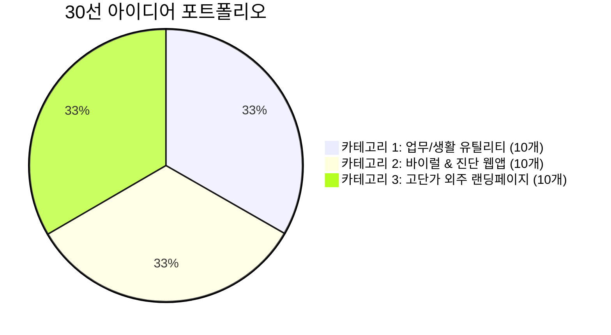

# 💡 돈이 되는 바이브코딩 실전 아이디어 30선

> **"무엇을 만들지 몰라 방황하는 시간을 0초로 줄여드립니다!"**
> 실제 시장(크몽, Gumroad, 와디즈, 숨고)에서 수요가 검증되었으며, 코딩 초보자가 AI와 함께 1일~3일 만에 만들 수 있는 30가지 알짜배기 아이디어 모음입니다.

---

## 📊 아이디어 카테고리 요약

---

## 🧮 [카테고리 1] 업무 & 생활 유틸리티 웹앱 (10선)
*특징: 데이터베이스 없이 브라우저에서 바로 계산/변환되는 도구. 초보자 최적!*

| 번호 | 프로젝트명 | 난이도 | 핵심 가치 및 타깃 | 추천 수익화 방식 | 권장 판매가 |
| :---: | :--- | :---: | :--- | :--- | :--- |
| **01** | **프리랜서 3.3% 실수령액 & 세금 계산기** | ⭐ | 사업소득세/지방세 및 4대보험 공제 실시간 계산 | 무료 배포 + 토스 커피 후원 + 외주 배너 | 무료 / 후원 |
| **02** | **스마트스토어/쿠팡 마진율 계산기** | ⭐⭐ | 플랫폼별 수수료, 택배비, 부가세 포함 순마진율 계산 | 크몽 엑셀 대체 웹툴 판매 / 애드센스 | 9,900원 |
| **03** | **인스타그램 줄바꿈 & 특수폰트 변환기** | ⭐ | 피드 본문 줄바꿈 공백 유지 및 예쁜 영어 폰트 변환 | 무료 공개 후 바이럴 트래픽 + 제휴 마케팅 | 트래픽 수익 |
| **04** | **유튜브 영상 길이 & 스크립트 분량 계산기** | ⭐⭐ | 대본 글자 수를 말하는 속도(WPM) 기준 영상 분량으로 환산 | 영상 편집자 커뮤니티 타깃 Gumroad 판매 | $5 (약 7,000원) |
| **05** | **주휴수당 & 알바 시급 종합 계산기** | ⭐ | 2026년 최저시급 기준 야간/휴일/주휴 자동 계산 | 알바생/사장님 커뮤니티 배포 + 노무사 배너 광고 | 제휴 배너 |
| **06** | **D-Day & 목표 달성 퍼센트 시각화 위젯** | ⭐⭐ | 시험, 결혼, 전역, 저축 목표를 시각적 프로그레스 바로 표시 | 노션(Notion) 임베드용 위젯 패키지 판매 | 4,900원 |
| **07** | **부동산 중개보수(복비) & 취득세 계산기** | ⭐⭐ | 매매/전세/월세 금액별 상한 요율 자동 적용 계산 | 공인중개사 전용 블로그/홈페이지 위젯 외주 | 건당 15만 원 |
| **08** | **PDF 파일 텍스트 추출 & 요약 웹툴** | ⭐⭐⭐ | 브라우저에서 PDF 올리면 주요 내용 3줄 요약 (AI API 연동) | Gumroad 글로벌 판매 (월 구독 모델) | 월 $4.99 |
| **09** | **자주 쓰는 이메일/업무 메시지 템플릿 복사기** | ⭐ | 상황별(거절, 일정조율, 견적요청) 템플릿 클릭 한 번에 복사 | 직장인 커뮤니티 바이럴 + 생산성 전자책 번들 | 12,000원 |
| **10** | **환율 계산 & 여행 경비 분할(더치페이) 계산기** | ⭐⭐ | 실시간 환율 적용 및 N명이 쓴 경비 원화로 정산 | 여행자 오픈채팅방 공유 + 여행자보험 제휴 링크 | 제휴 수수료 |

---

## 🔮 [카테고리 2] 바이럴 & 진단 인터랙티브 웹앱 (10선)
*특징: SNS(인스타, 카톡)에서 자발적으로 공유되어 폭발적인 트래픽을 모으는 도구.*

| 번호 | 프로젝트명 | 난이도 | 핵심 가치 및 타깃 | 추천 수익화 방식 | 권장 판매가 |
| :---: | :--- | :---: | :--- | :--- | :--- |
| **11** | **나에게 맞는 부업 유형 테스트 (부업 MBTI)** | ⭐⭐ | 7가지 질문으로 내 성향(외주형/자산형/콘텐츠형) 진단 | 진단 결과 하단에 유료 전자책/강의 링크 연결 | 전환율 극대화 |
| **12** | **퍼스널 브랜딩 컬러 & 키워드 추천기** | ⭐⭐ | 내 업종과 가치관을 선택하면 조화로운 색상 코드와 슬로건 제안 | 1인 기업가 대상 Gumroad 템플릿 판매 | 9,900원 |
| **13** | **오늘 뭐 먹지? 인터랙티브 룰렛 / 사다리타기** | ⭐ | 직장인 점심 메뉴 및 회식 메뉴 결정 장애 해결 도구 | 로컬 맛집 배너 광고 & 카카오 애드핏 | 광고 수익 |
| **14** | **하루 5분 디지털 디톡스 타이머 & 명상 사운드** | ⭐⭐ | 빗소리, 모닥불 소리와 함께 작동하는 미니멀 집중 타이머 | 노션 위젯 판매 & 유료 프리미엄 사운드팩 | 5,900원 |
| **15** | **AI 프롬프트 생성 인터랙티브 퀴즈** | ⭐⭐⭐ | 초보자가 객관식만 고르면 고품질 미드저니/챗GPT 프롬프트 완성 | 크몽 프롬프트 엔지니어링 패키지 판매 | 19,000원 |
| **16** | **반려동물 나이 사람 나이 환산 & 건강 체크** | ⭐ | 강아지/고양이 종별 나이 및 주기별 예방접종 알리미 | 반려동물 용품 쿠팡 파트너스 링크 연계 | 제휴 수익 |
| **17** | **나의 번아웃 지수 자가진단 체크리스트** | ⭐⭐ | 스트레스 단계별 처방전과 위로의 문장 카드 이미지 다운로드 | 인스타 공유 유도 → 뉴스레터 구독자 모객 | 리드 수집 |
| **18** | **독서 습관 트래커 & 1년 독서 목표 진행률** | ⭐⭐ | 읽은 책 등록 시 가상 서재 책장에 책이 꽂히는 시각화 | 북스타그램 인플루언서 제휴 & 굿즈 판매 | 6,900원 |
| **19** | **자산 목표 달성 시뮬레이터 (FIRE족 계산기)** | ⭐⭐ | 월 저축액과 수익률 입력 시 은퇴 가능 시점을 그래프로 출력 | 재테크 블로그/유튜브 링크 및 도서 제휴 | 제휴 마케팅 |
| **20** | **축의금 / 부의금 적정 금액 진단기** | ⭐ | 친밀도, 참석 여부, 식대 비용에 따른 빅데이터 적정 금액 제안 | 명절/결혼 시즌 커뮤니티 바이럴 트래픽 확보 | 트래픽 수익 |

---

## 🏢 [카테고리 3] 고단가 외주 랜딩페이지 & 소상공인 웹솔루션 (10선)
*특징: 건당 20만 원 ~ 100만 원을 받고 클라이언트에게 맞춤 제작해주는 B2B 영역.*

| 번호 | 프로젝트명 | 난이도 | 핵심 기능 및 타깃 고객 | 외주 수주 플랫폼 | 표준 외주 견적 |
| :---: | :--- | :---: | :--- | :--- | :--- |
| **21** | **와디즈/텀블벅 펀딩 사전예약 랜딩페이지** | ⭐⭐ | 카운트다운 타이머, 이메일/전화번호 알림신청 폼 | 크몽 / 텀블벅 창작자 DM | 30만 ~ 50만 원 |
| **22** | **프리미엄 카페 / 베이커리 모바일 소개 페이지** | ⭐⭐ | 감성 사진 갤러리, 네이버 지도 연동, 인스타그램 피드 | 숨고 / 동네 소상공인 직접 영업 | 40만 ~ 70만 원 |
| **23** | **1:1 피트니스 PT샵 / 필라테스 무료체험 신청 페이지** | ⭐⭐ | 강사 프로필, 비포애프터 슬라이더, 카카오톡 상담 버튼 | 당근마켓 비즈프로필 / 숨고 | 50만 ~ 80만 원 |
| **24** | **변호사 / 세무사 / 행정사 1:1 상담 예약 랜딩페이지** | ⭐⭐⭐ | 전문 분야 소개, 구글 시트 연동 비공개 온라인 상담 접수 | 크몽 법률/비즈니스 카테고리 | 60만 ~ 100만 원 |
| **25** | **1인 지식창업가 / 강의 강사 포트폴리오 사이트** | ⭐⭐ | 강사 약력, 강의 후기 아코디언, 강의 신청 링크 연동 | 크몽 / 노션 사용자 커뮤니티 | 35만 ~ 60만 원 |
| **26** | **인테리어 / 시공 업체 간이 견적 산출기** | ⭐⭐⭐ | 평수, 공사 범위 선택 시 예상 견적서 즉시 생성 및 다운로드 | 숨고 인테리어 업체 제안 | 70만 ~ 120만 원 |
| **27** | **모바일 청첩장 / 돌잔치 초대장 독립형 웹** | ⭐⭐ | 갤러리, 방명록, 참석 여부(RSVP) 설문, 계좌번호 복사 | 크몽 이벤트 제작 카테고리 | 건당 15만 ~ 30만 원 |
| **28** | **원데이 클래스 / 공방 예약 및 커리큘럼 페이지** | ⭐⭐ | 클래스 일정표, 소수정예 잔여석 표시, 네이버페이 링크 | 아이디어스 입점 작가 / 인스타 DM | 35만 ~ 55만 원 |
| **29** | **B2B SaaS / 소프트웨어 솔루션 제품 소개 랜딩페이지** | ⭐⭐⭐ | 기능 비교표, 요금제 플랜 카드, 무료 데모 신청 폼 | IT 스타트업 커뮤니티 (디스콰이엇) | 80만 ~ 150만 원 |
| **30** | **식당 모바일 QR 메뉴판 & 테이블 주문 웹페이지** | ⭐⭐ | 테이블 QR코드 스캔 시 메뉴 사진, 알레르기 안내, 호출 버튼 | 소상공인 식당/주점 오프라인 영업 | 50만 ~ 90만 원 |

---

## 🎯 초보자를 위한 추천 액션 플랜

1. **오늘 당장 시작한다면:** 카테고리 1번의 **01번(프리랜서 계산기)** 또는 **06번(D-Day 위젯)**을 선택하세요.
2. **첫 외주를 도전한다면:** 카테고리 3번의 **22번(카페 소개 페이지)** 또는 **23번(PT샵 신청 페이지)** 가상 데모를 만들어 포트폴리오로 등록하세요.
3. 기획이 끝났다면 [[Templates/템플릿_아이디어_기획서|아이디어 기획 템플릿]]을 열고 내용을 채워 넣으세요!
